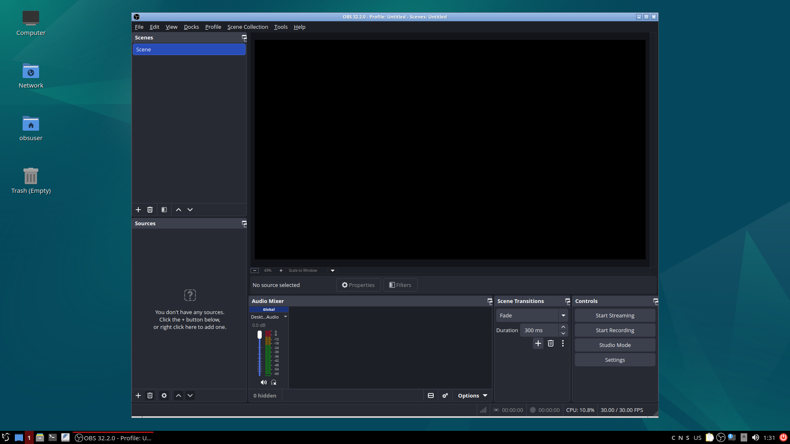
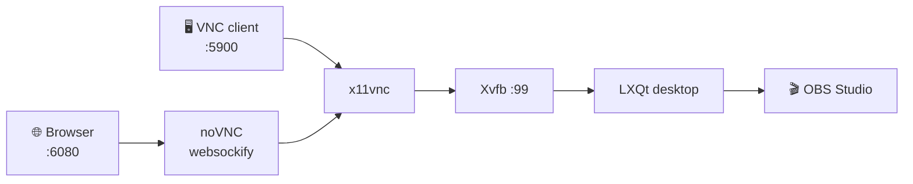
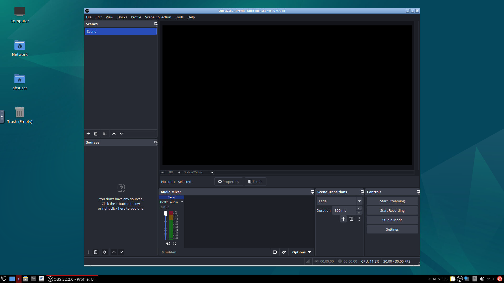

<div align="center">

# 🎥 OBS Docker — Legacy

### OBS Studio on a headless Linux desktop — the Ubuntu 24.04 time capsule.

Stream, record and produce from a server with **no monitor, no GPU and no local install.**

[![Docker Pulls][badge-pulls]][dockerhub]
[![Image Size][badge-size]][dockerhub]
[![GHCR][badge-ghcr]][ghcr]
[![License][badge-license]][license]
[![Platform][badge-platform]](#requirements)

[**Quick start**](#quick-start) · [**Channels**](#channels) · [**Configuration**](#configuration) · [**FAQ**](#faq) · [**Report a bug**][issues]

</div>

<div align="center">
  
  <br>
  <sub>OBS Studio running inside the container — no local desktop required.</sub>
</div>

---

> [!CAUTION]
> **This is the `legacy` channel.** It is frozen on **Ubuntu 24.04**, receives no new features and only critical fixes. New deployments should use [`main`](https://github.com/AlexanderWagnerDev/obs-docker/tree/main).

> [!TIP]
> **In a hurry?** Run the one-liner below and open <http://localhost:6080>. No client, no install, no desktop required.

```bash
docker run -d --name obs-docker --restart always \
  -e VNC_PASS='change-me' \
  -p 5900:5900 -p 6080:6080 \
  --shm-size=8g \
  alexanderwagnerdev/obs:legacy
```

---

## ✨ Why OBS Docker?

| | Feature | What you get |
|---|---------|--------------|
| 🖥️ | **A real desktop** | Full LXQt session with panel, file manager, terminal and app launcher |
| 🌐 | **Browser-first** | noVNC on port `6080` — control everything from any browser |
| 🎛️ | **VNC ready** | Native clients on port `5900` whenever you want lower latency |
| 🎬 | **OBS preinstalled** | Latest OBS Studio from the official PPA, started automatically on boot |
| 🧰 | **Media toolbox** | FFmpeg, GStreamer, VLC, Firefox and Chromium included |
| 🐳 | **Two registries** | Docker Hub **and** GHCR, published with identical tags |
| 🔐 | **Password protected** | VNC and noVNC secured through `VNC_PASS` |
| 🩺 | **Self-checking** | Built-in `HEALTHCHECK` verifies noVNC on port `6080` |

---

<a name="channels"></a>
## 🚦 Channels

| Branch | Tag | Base | Stability | Best for |
|--------|-----|------|-----------|----------|
| `main` | `latest` | Ubuntu 26.04 | ✅ Stable | Production |
| `beta` | `beta` | Ubuntu 26.04 | 🧪 Testing | Trying what's next |
| **`legacy`** | `legacy` | Ubuntu 24.04 | 🧊 **Frozen** | Existing deployments |

Pull the same tag from either registry:

```bash
docker pull alexanderwagnerdev/obs:legacy         # Docker Hub
docker pull ghcr.io/alexanderwagnerdev/obs:legacy  # GitHub Container Registry
```

---

<a name="how-it-works"></a>
## 🗺️ How it works



Everything runs inside a single container. Xvfb provides a virtual display, LXQt gives you a desktop, OBS does the streaming, and x11vnc/noVNC expose it.

---

<a name="quick-start"></a>
## 🚀 Quick Start

### Docker Compose (recommended)

```bash
git clone -b legacy https://github.com/AlexanderWagnerDev/obs-docker.git
cd obs-docker
cp .env.example .env      # set VNC_PASS, TZ, LOCALE, KEYBOARD_LAYOUT
docker compose up -d
```

The included `docker-compose.yml` is ready to go:

```yaml
services:
  obs-docker:
    image: alexanderwagnerdev/obs:legacy
    container_name: obs-docker
    restart: always
    environment:
      - VNC_PASS=${VNC_PASS}
      - LOCALE=${LOCALE}
      - TZ=${TZ}
      - KEYBOARD_LAYOUT=${KEYBOARD_LAYOUT}
    ports:
      - "5900:5900"
      - "6080:6080"
    shm_size: "8gb"
    tmpfs:
      - /tmp:exec,mode=1777
```

### Docker CLI

```bash
docker run -d \
  --name obs-docker \
  --restart always \
  -e VNC_PASS='change-me' \
  -e TZ=Europe/Vienna \
  -e LOCALE=de_AT.UTF-8 \
  -e KEYBOARD_LAYOUT=de \
  -p 5900:5900 \
  -p 6080:6080 \
  --shm-size=8g \
  alexanderwagnerdev/obs:legacy
```

> [!IMPORTANT]
> `--shm-size=8g` is strongly recommended. The default 64 MB shared memory is too small for browsers and video pipelines.

---

<a name="configuration"></a>
## ⚙️ Configuration

| Variable | Default | Description |
|----------|---------|-------------|
| `VNC_PASS` | `OBS1234!` | Password for VNC / noVNC access |
| `LOCALE` | `en_US.UTF-8` | System locale, e.g. `de_AT.UTF-8` |
| `TZ` | `UTC` | Timezone, e.g. `Europe/Vienna` |
| `KEYBOARD_LAYOUT` | `us` | Keyboard layout, e.g. `de`, `us` |

```bash
cp .env.example .env
```

---

## 🔌 Ports

| Port | Protocol | Purpose |
|------|----------|---------|
| `5900` | TCP | VNC — RealVNC, TigerVNC, Remmina, … |
| `6080` | TCP | noVNC — any modern browser |

---

## 🖥️ Access

| Method | Address | Notes |
|--------|---------|-------|
| Browser | `http://your-ip:6080` | Zero install, works everywhere |
| VNC client | `your-ip:5900` | Lower latency, better for long sessions |

> OBS Studio launches automatically when the container starts.

<div align="center">
  
  <br>
  <sub>The same desktop in your browser via noVNC on port 6080.</sub>
</div>

---

## 📦 What's inside

- **OBS Studio** — latest release from the official OBS PPA
- **LXQt** — lightweight desktop environment (`lxqt-core` metapackage)
- **Firefox & Chromium** — two browsers for maximum compatibility with browser sources
- **VLC** — media playback and capture
- **FFmpeg** — video/audio processing
- **GStreamer** — full plugin set (base, good, bad, ugly, libav)
- **PulseAudio + PavuControl** — audio routing and mixing
- **v4l2loopback** — virtual camera support
- **noVNC / x11vnc / Xvfb** — the remote desktop stack

---

<a name="requirements"></a>
## ✅ Requirements

- Docker Engine 24+ or Docker Desktop
- **`linux/amd64`** host (images are not published for ARM)
- 2 GB+ RAM recommended for OBS plus a browser
- Ports `5900` and/or `6080` reachable from your client

---

## 🩺 Operations

```bash
docker logs -f obs-docker                              # follow logs
docker exec -it obs-docker bash                        # shell inside the container
docker compose pull && docker compose up -d            # update to the latest image
```

> [!NOTE]
> Container data is **not persisted** by default. Mount a volume if you want to keep OBS scenes, recordings or browser profiles across recreations.

---

<a name="faq"></a>
## ❓ FAQ

<details>
<summary><b>Does it need a GPU?</b></summary>

No. OBS uses software encoding by default. Hardware encoding is possible only if you pass the required devices into the container.
</details>

<details>
<summary><b>Does it work on ARM (Apple Silicon, Raspberry Pi)?</b></summary>

The published images are `linux/amd64` only. You can build the Dockerfile locally for `arm64`, but it is untested.
</details>

<details>
<summary><b>Where are my recordings saved?</b></summary>

Inside the container, so they disappear when the container is removed. Mount a host directory or named volume and point OBS at it.
</details>

<details>
<summary><b>What is the difference between the tags?</b></summary>

`latest` is stable, `beta` is the pre-release channel and `legacy` is frozen on Ubuntu 24.04. See [Channels](#channels).
</details>

<details>
<summary><b>Should I still use legacy?</b></summary>

Only if you have an existing deployment that depends on Ubuntu 24.04 or Chromium. New setups should use `main`.
</details>

<details>
<summary><b>Can I run it behind a reverse proxy?</b></summary>

Yes. Put your proxy in front of port `6080`. For HTTPS, enable WebSocket support — noVNC requires it.
</details>

---

## 🛠️ Build from source

```bash
git clone -b legacy https://github.com/AlexanderWagnerDev/obs-docker.git
cd obs-docker
docker build -t obs-docker .
docker run -d --name obs-docker -p 6080:6080 -p 5900:5900 \
  --shm-size=8g -e VNC_PASS='change-me' obs-docker
```

Images are built manually through the **Docker Image Build** workflow (`workflow_dispatch`).

---

## 🤝 Contributing

Issues and pull requests are welcome. The branch model is simple:

- `main` — stable, production-ready
- `beta` — next release, may break
- `legacy` — frozen, critical fixes only

Dependabot keeps actions, the Dockerfile and Compose files up to date on all three branches.

---

## 🔗 Links

- **Docker Hub:** [alexanderwagnerdev/obs][dockerhub]
- **GHCR:** [ghcr.io/alexanderwagnerdev/obs][ghcr]
- **Base image:** [AlexanderWagnerDev/ubuntu-docker](https://github.com/AlexanderWagnerDev/ubuntu-docker)
- **Issues:** [GitHub Issues][issues]

## 📄 License

See the [LICENSE][license] file for details.

---

<div align="center">

**If this project saves you time, consider giving it a ⭐ — it helps others find it.**

Made with ❤️ for the streaming community.

</div>

[badge-pulls]: https://img.shields.io/docker/pulls/alexanderwagnerdev/obs?style=for-the-badge&logo=docker&logoColor=white
[badge-size]: https://img.shields.io/docker/image-size/alexanderwagnerdev/obs/legacy?style=for-the-badge&label=image%20size
[badge-ghcr]: https://img.shields.io/badge/GHCR-alexanderwagnerdev%2Fobs-2496ED?style=for-the-badge&logo=github&logoColor=white
[badge-license]: https://img.shields.io/github/license/AlexanderWagnerDev/obs-docker?style=for-the-badge
[badge-platform]: https://img.shields.io/badge/platform-linux%2Famd64-6e7681?style=for-the-badge&logo=linux&logoColor=white
[dockerhub]: https://hub.docker.com/r/alexanderwagnerdev/obs
[ghcr]: https://github.com/AlexanderWagnerDev/obs-docker/pkgs/container/obs
[license]: https://github.com/AlexanderWagnerDev/obs-docker/blob/legacy/LICENSE
[issues]: https://github.com/AlexanderWagnerDev/obs-docker/issues
