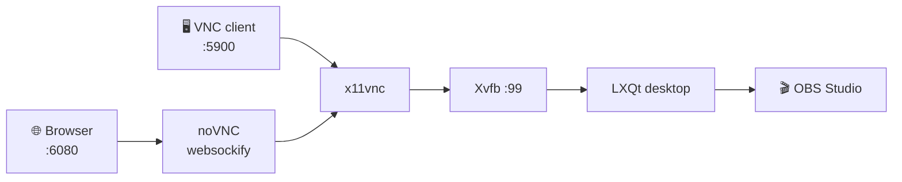

<div align="center">

# 🎥 OBS Docker

### OBS Studio on a headless Linux desktop — in your browser, from anywhere.

Stream, record and produce from a server with **no monitor and no local install** — CPU-only by default, hardware encoding if you have a GPU.

[![Docker Pulls][badge-pulls]][dockerhub]
[![Image Size][badge-size]][dockerhub]
[![GHCR][badge-ghcr]][ghcr]
[![License][badge-license]][license]
[![Platform][badge-platform]](#requirements)

[**Quick start**](#quick-start) · [**Channels**](#channels) · [**GPU**](#gpu) · [**Configuration**](#configuration) · [**FAQ**](#faq) · [**Report a bug**][issues]

</div>

<div align="center">
  
  <br>
  <sub>OBS Studio running inside the container — no local desktop required.</sub>
</div>

---

> [!TIP]
> **In a hurry?** Run the one-liner below and open <http://localhost:6080>. No client, no install, no desktop required.

```bash
docker run -d --name obs-docker --restart always \
  -e VNC_PASS='change-me' \
  -p 5900:5900 -p 6080:6080 \
  --shm-size=8g \
  alexanderwagnerdev/obs:latest
```

---

## ✨ Why OBS Docker?

| | Feature | What you get |
|---|---------|--------------|
| 🖥️ | **A real desktop** | Full LXQt session with panel, file manager, terminal and app launcher |
| 🌐 | **Browser-first** | noVNC on port `6080` — control everything from any browser |
| 🎛️ | **VNC ready** | Native clients on port `5900` whenever you want lower latency |
| 🎬 | **OBS preinstalled** | Latest OBS Studio from the official PPA, started automatically on boot |
| 🎮 | **Optional GPU** | Dedicated tags for NVIDIA (NVENC), AMD and Intel (VA-API) hardware encoding |
| 🧰 | **Media toolbox** | FFmpeg, GStreamer, VLC and Firefox included |
| 🐳 | **Two registries** | Docker Hub **and** GHCR, published with identical tags |
| 🔐 | **Password protected** | VNC and noVNC secured through `VNC_PASS` |
| 🩺 | **Self-checking** | Built-in `HEALTHCHECK` verifies noVNC on port `6080` |

---

<a name="channels"></a>
## 🚦 Channels

| Branch | Tag | Base | Stability | Best for |
|--------|-----|------|-----------|----------|
| **`main`** | `latest` | Ubuntu 26.04 | ✅ **Stable** | Production |
| `beta` | `beta` | Ubuntu 26.04 | 🧪 Testing | Trying what's next |
| `legacy` | `legacy` | Ubuntu 24.04 | 🧊 Frozen | Existing deployments |
| `gpu` | `gpu` | Ubuntu 26.04 | 🎮 GPU | All GPUs, vendor autodetect |
| `nvidia` | `nvidia` | Ubuntu 26.04 | 🎮 GPU | NVENC |
| `amd` | `amd` | Ubuntu 26.04 | 🎮 GPU | VA-API (radeonsi) |
| `intel` | `intel` | Ubuntu 26.04 | 🎮 GPU | VA-API (iHD) |

Pull the same tag from either registry:

```bash
docker pull alexanderwagnerdev/obs:latest         # Docker Hub
docker pull ghcr.io/alexanderwagnerdev/obs:latest  # GitHub Container Registry
```

Hardware encoding variants are published as `:gpu`, `:nvidia`, `:amd` and `:intel` — see [GPU acceleration](#gpu).

---

<a name="gpu"></a>
## 🎮 GPU acceleration

The GPU tags hand OBS hardware **encoding** (NVIDIA NVENC, AMD and Intel VA-API). They do not turn the container into a GPU-accelerated desktop: the session still runs on Xvfb, so previews and OpenGL/Vulkan sources are rendered on the CPU (`llvmpipe`). Encoding is where the GPU matters for streaming and recording.

| Tag | Vendor | Added userspace | Encoders in OBS |
|-----|--------|-----------------|-----------------|
| `latest` | – | – | `x264` (software) |
| `gpu` | all | union of the three below + vendor autodetect | everything below |
| `nvidia` | NVIDIA | `libva`/`libvdpau`/`libegl` bridges, `nvidia-vaapi-driver` | NVENC H.264 / HEVC / AV1 |
| `amd` | AMD | `mesa-libgallium` (radeonsi), `mesa-vulkan-drivers`, `vainfo` | VA-API H.264 / HEVC / AV1 |
| `intel` | Intel | `intel-media-va-driver-non-free` (iHD), `i965-va-driver`, Mesa, `vainfo` | VA-API (iHD) H.264 / HEVC / AV1 |

All four variants are built from their **own branch** (`gpu`, `nvidia`, `amd`, `intel`) and share the same base image. The driver itself is always provided by the host — the branches only differ in the userspace packages they add.

### NVIDIA

Requires a host driver plus the [NVIDIA Container Toolkit](https://docs.nvidia.com/datacenter/cloud-native/container-toolkit/latest/install-guide.html).

```bash
docker run -d --name obs-docker --gpus all \
  -e NVIDIA_DRIVER_CAPABILITIES=all \
  -e VNC_PASS='change-me' \
  -p 5900:5900 -p 6080:6080 --shm-size=8g \
  alexanderwagnerdev/obs:nvidia
```

> [!IMPORTANT]
> `NVIDIA_DRIVER_CAPABILITIES` must include `video` (or be `all`). Otherwise the toolkit does not mount `libnvidia-encode.so` and NVENC never shows up in OBS.

### AMD and Intel

Requires `/dev/dri` on the host. Both use the same Mesa stack and differ only in the VA-API driver, so the snippets are identical apart from the tag.

```bash
docker run -d --name obs-docker \
  --device /dev/dri \
  --group-add "$(stat -c '%g' /dev/dri/renderD128)" \
  -e VNC_PASS='change-me' \
  -p 5900:5900 -p 6080:6080 --shm-size=8g \
  alexanderwagnerdev/obs:amd     # or :intel
```

The numeric `render` GID is required: the image has no `render` group, and the host GID usually differs from anything inside the container. `video` alone is not enough — VA-API uses the render node.

### Docker Compose

```yaml
# NVIDIA
services:
  obs:
    image: alexanderwagnerdev/obs:nvidia
    environment:
      - NVIDIA_DRIVER_CAPABILITIES=all
    deploy:
      resources:
        reservations:
          devices:
            - driver: nvidia
              count: all
              capabilities: [gpu, video]
```

```yaml
# AMD / Intel
services:
  obs:
    image: alexanderwagnerdev/obs:amd   # or :intel
    devices:
      - /dev/dri:/dev/dri
    group_add:
      - video
      - "993"   # GID of the host's render group: stat -c '%g' /dev/dri/renderD128
```

### The `:gpu` tag

`:gpu` contains all three userspace stacks and selects the right VA-API backend at startup by checking `/dev/nvidia*` and the PCI vendor IDs under `/sys/class/drm`. It is larger than the vendor tags, but one tag covers mixed fleets.

```bash
docker logs obs-docker | grep GPU     # e.g. "GPU: amd (VA-API: radeonsi)"
```

Override the detection with `-e GPU_VENDOR=amd|intel|nvidia`, or force a backend with `-e LIBVA_DRIVER_NAME=radeonsi|iHD|i965|nvidia`.

### Verifying hardware encoding

```bash
docker exec obs-docker vainfo        # AMD / Intel: driver + supported profiles
docker exec obs-docker nvidia-smi    # NVIDIA
```

Then in OBS open **Settings → Output → Encoder** and pick `NVENC H.264` on NVIDIA or `FFmpeg VAAPI H.264` on AMD/Intel. If only `x264` is listed, the device or the environment variable is missing.

> [!NOTE]
> Ubuntu 26.04 ships the AMD VA-API driver inside `mesa-libgallium` — the former `mesa-va-drivers` package no longer exists, which is why older guides fail here. `intel-media-va-driver` and `intel-media-va-driver-non-free` also conflict; the images use `-non-free` for the full codec set.

---

<a name="how-it-works"></a>
## 🗺️ How it works



Everything runs inside a single container. Xvfb provides a virtual display, LXQt gives you a desktop, OBS does the streaming, and x11vnc/noVNC expose it.

---

<a name="quick-start"></a>
## 🚀 Quick Start

### Docker Compose (recommended)

```bash
git clone https://github.com/AlexanderWagnerDev/obs-docker.git
cd obs-docker
cp .env.example .env      # set VNC_PASS, TZ, LOCALE, KEYBOARD_LAYOUT
docker compose up -d
```

The included `docker-compose.yml` is ready to go:

```yaml
services:
  obs-docker:
    image: alexanderwagnerdev/obs:latest
    container_name: obs-docker
    restart: always
    environment:
      - VNC_PASS=${VNC_PASS}
      - LOCALE=${LOCALE}
      - TZ=${TZ}
      - KEYBOARD_LAYOUT=${KEYBOARD_LAYOUT}
    ports:
      - "5900:5900"
      - "6080:6080"
    shm_size: "8gb"
    tmpfs:
      - /tmp:exec,mode=1777
```

### Docker CLI

```bash
docker run -d \
  --name obs-docker \
  --restart always \
  -e VNC_PASS='change-me' \
  -e TZ=Europe/Vienna \
  -e LOCALE=de_AT.UTF-8 \
  -e KEYBOARD_LAYOUT=de \
  -p 5900:5900 \
  -p 6080:6080 \
  --shm-size=8g \
  alexanderwagnerdev/obs:latest
```

> [!IMPORTANT]
> `--shm-size=8g` is strongly recommended. The default 64 MB shared memory is too small for browsers and video pipelines.

---

<a name="configuration"></a>
## ⚙️ Configuration

| Variable | Default | Description |
|----------|---------|-------------|
| `VNC_PASS` | `OBS1234!` | Password for VNC / noVNC access |
| `LOCALE` | `en_US.UTF-8` | System locale, e.g. `de_AT.UTF-8` |
| `TZ` | `UTC` | Timezone, e.g. `Europe/Vienna` |
| `KEYBOARD_LAYOUT` | `us` | Keyboard layout, e.g. `de`, `us` |
| `GPU_VENDOR` | auto-detected | GPU tags only — force `amd`, `intel` or `nvidia` |
| `LIBVA_DRIVER_NAME` | auto-detected | Override the VA-API backend: `radeonsi`, `iHD`, `i965` or `nvidia` |

```bash
cp .env.example .env
```

---

## 🔌 Ports

| Port | Protocol | Purpose |
|------|----------|---------|
| `5900` | TCP | VNC — RealVNC, TigerVNC, Remmina, … |
| `6080` | TCP | noVNC — any modern browser |

---

## 🖥️ Access

| Method | Address | Notes |
|--------|---------|-------|
| Browser | `http://your-ip:6080` | Zero install, works everywhere |
| VNC client | `your-ip:5900` | Lower latency, better for long sessions |

> OBS Studio launches automatically when the container starts.

<div align="center">
  
  <br>
  <sub>The same desktop in your browser via noVNC on port 6080.</sub>
</div>

---

## 📦 What's inside

- **OBS Studio** — latest release from the official OBS PPA
- **LXQt** — lightweight desktop environment
- **Firefox** — web browser, great for browser sources
- **VLC** — media playback and capture
- **FFmpeg** — video/audio processing
- **GStreamer** — full plugin set (base, good, bad, ugly, libav)
- **PulseAudio + PavuControl** — audio routing and mixing
- **noVNC / x11vnc / Xvfb** — the remote desktop stack
- **GPU userspace** (optional tags) — Mesa/VA-API for AMD and Intel, VA-API/EGL bridges for NVIDIA

---

<a name="requirements"></a>
## ✅ Requirements

- Docker Engine 24+ or Docker Desktop
- **`linux/amd64`** host (images are not published for ARM)
- 2 GB+ RAM recommended for OBS plus a browser
- Ports `5900` and/or `6080` reachable from your client
- Optional, for the GPU tags only: an NVIDIA driver with the Container Toolkit, or `/dev/dri` access for AMD/Intel

---

## 🩺 Operations

```bash
docker logs -f obs-docker                              # follow logs
docker exec -it obs-docker bash                        # shell inside the container
docker compose pull && docker compose up -d            # update to the latest image
```

> [!NOTE]
> Container data is **not persisted** by default. Mount a volume if you want to keep OBS scenes, recordings or browser profiles across recreations.

---

<a name="faq"></a>
## ❓ FAQ

<details>
<summary><b>Does it need a GPU?</b></summary>

No. `latest` encodes with `x264` on the CPU. If you want hardware encoding, use the `:nvidia`, `:amd`, `:intel` or `:gpu` tags — see [GPU acceleration](#gpu).
</details>

<details>
<summary><b>Does it work on ARM (Apple Silicon, Raspberry Pi)?</b></summary>

The published images are `linux/amd64` only. You can build the Dockerfile locally for `arm64`, but it is untested.
</details>

<details>
<summary><b>Where are my recordings saved?</b></summary>

Inside the container, so they disappear when the container is removed. Mount a host directory or named volume and point OBS at it.
</details>

<details>
<summary><b>What is the difference between the tags?</b></summary>

`latest` is stable, `beta` is the pre-release channel and `legacy` is frozen on Ubuntu 24.04. See [Channels](#channels).
</details>

<details>
<summary><b>Can I run it behind a reverse proxy?</b></summary>

Yes. Put your proxy in front of port `6080`. For HTTPS, enable WebSocket support — noVNC requires it.
</details>

---

## 🛠️ Build from source

```bash
git clone https://github.com/AlexanderWagnerDev/obs-docker.git
cd obs-docker
docker build -t obs-docker .                      # CPU-only, equals :latest
git checkout nvidia && docker build -t obs-docker:nvidia .
git checkout amd    && docker build -t obs-docker:amd .
git checkout intel  && docker build -t obs-docker:intel .
git checkout gpu    && docker build -t obs-docker:gpu .
docker run -d --name obs-docker -p 6080:6080 -p 5900:5900 \
  --shm-size=8g -e VNC_PASS='change-me' obs-docker
```

Images are built per branch through the **Docker Image Build** workflow (`workflow_dispatch`). Every branch publishes its own tag (`main` → `latest`, `beta` → `beta`, `legacy` → `legacy`, plus `gpu`, `nvidia`, `amd` and `intel`) to both registries.

---

## 🤝 Contributing

Issues and pull requests are welcome. The branch model is simple:

- `main` — stable, production-ready
- `beta` — next release, may break
- `legacy` — frozen, critical fixes only
- `gpu`, `nvidia`, `amd`, `intel` — GPU variants, same base as `main`

Dependabot keeps actions, the Dockerfile and Compose files up to date on every branch.

---

## 🔗 Links

- **Docker Hub:** [alexanderwagnerdev/obs][dockerhub]
- **GHCR:** [ghcr.io/alexanderwagnerdev/obs][ghcr]
- **Base image:** [AlexanderWagnerDev/ubuntu-docker](https://github.com/AlexanderWagnerDev/ubuntu-docker)
- **Issues:** [GitHub Issues][issues]

## 📄 License

See the [LICENSE][license] file for details.

---

<div align="center">

**If this project saves you time, consider giving it a ⭐ — it helps others find it.**

Made with ❤️ for the streaming community.

</div>

[badge-pulls]: https://img.shields.io/docker/pulls/alexanderwagnerdev/obs?style=for-the-badge&logo=docker&logoColor=white
[badge-size]: https://img.shields.io/docker/image-size/alexanderwagnerdev/obs/latest?style=for-the-badge&label=image%20size
[badge-ghcr]: https://img.shields.io/badge/GHCR-alexanderwagnerdev%2Fobs-2496ED?style=for-the-badge&logo=github&logoColor=white
[badge-license]: https://img.shields.io/github/license/AlexanderWagnerDev/obs-docker?style=for-the-badge
[badge-platform]: https://img.shields.io/badge/platform-linux%2Famd64-6e7681?style=for-the-badge&logo=linux&logoColor=white
[dockerhub]: https://hub.docker.com/r/alexanderwagnerdev/obs
[ghcr]: https://github.com/AlexanderWagnerDev/obs-docker/pkgs/container/obs
[license]: https://github.com/AlexanderWagnerDev/obs-docker/blob/main/LICENSE
[issues]: https://github.com/AlexanderWagnerDev/obs-docker/issues
